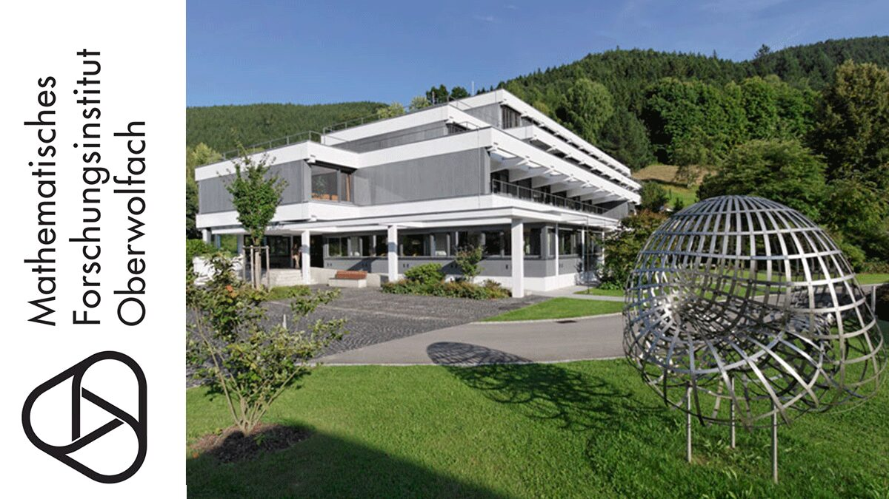

  

I attended the Oberwolfach Arbeitsgemeinschaft[^arbeitsgemeinschaft] (AG) 
["From Trees to Bands: Discrete Localization, Unique Continuation, and Propagation"](https://www.mfo.de/www/activity/2641) 
focused on the mathematics of [Anderson localization](https://en.wikipedia.org/wiki/Anderson_localization).
In particular, we looked into localization and delocalization phenomena 
for discrete random Schrödinger operators and related random matrix and graph models.
We worked through much of [[AW15]](https://pubs.ams.org/ebooks/gsm/168) for foundational material along
with several research papers on recent developments.

In the spirit of Arbeitsgemeinschaft[^mfo-ag], I gave a presentation on 
finite-rank perturbation theory, especially on the Simon-Wolff Criterion 
[SW86] and a boosting of Simon-Wolff via Kolmogorov's 0-1 law [AW15b].

I'll try to post notes for the talk in [Math]({{ '/math' | relative_url }}) if they come out nice and error-free enough.

#### References
[AW15a] M. Aizenman and S. Warzel. **Random Operators.** Graduate Studies in Mathematics. American
Mathematical Society, 2015

[AW15b] Michael Aizenman and Simone Warzel. **Boosted Simon-Wolff Spectral Criterion and Resonant Delocalization.** 
Communications on Pure and Applied Mathematics, 69(11):2195–2218, December 2015.

[SW86] Barry Simon and Tom Wolff. **Singular Continuous Spectrum Under Rank One Perturbations and Localization for Random Hamiltonians.** Communications on pure and applied mathematics,
39(1):75–90, 1986.

[^arbeitsgemeinschaft]: This roughly translates to "working group" or "teamwork", for my fellow Germanically-challenged folks. For anthropological purposes, or fun, compare the Wikipedia entries of [Arbeitsgemeinschaft](https://de.wikipedia.org/wiki/Arbeitsgemeinschaft) (presumably written by Germans) and [Teamwork](https://en.wikipedia.org/wiki/Teamwork) (presumably written by Americans); the former reads formal and legalese-like and the latter like something out of a workplace training video. To be fair, I can't read German, so some things may have been lost in (Google) translation.

[^mfo-ag]: MFO AG's are essentially academic bootcamps where (mostly junior) researchers immerse themselves in a narrow research area among their peers with the goal of, as the name might suggest, collective work towards collective understanding. Importantly, and unlike some "teamwork" you may have experienced in the past, all (with few exceptions) participants are required to contribute; particularly, participants are assigned some material to read in advance from which they give a presentation that others can/should learn from and appreciate.
