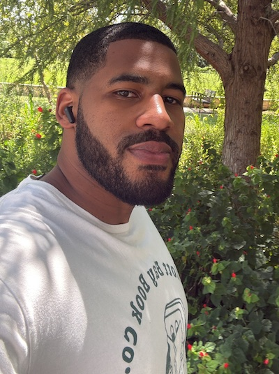

## Who Am I?
<figure class="intro-photo">
  
</figure>

My mathematical interests haven't settled quite yet, but I'm most partial to analysis and spectral theory at the moment,
and hope to work with [David Damanik](https://www.ruf.rice.edu/~dtd3/)[^damanik] on spectral theory and Schrödinger operators.[^schrodinger] 
These days, I spend most of my time doing homework and trying to master enough math to pass my quals.

My academic [odyssey](https://en.wikipedia.org/wiki/Odyssey) begins in Pittsburgh, PA where I 
eventually received B.S. & M.S. degrees ('21 & '22) in [ECE][ece][^ece] at [CMU][cmu].
Next stop is Houston, TX, where I began my graduate studies at the [Rice ECE Department][riceece]
under the guidance of [César A. Uribe][cesar] and [Santiago Segarra][santi],
ultimately resulting in a [Master's thesis](https://repository.rice.edu/items/87afda7a-6a85-452e-8954-02b11b7e0c2a) ('25) and a [couple of papers](https://scholar.google.com/citations?user=sw4tzEoAAAAJ&hl=en&authuser=1),
two of which were led by (the rising star) [Yifan Xu](https://mrhoggboss.github.io/).[^rising-star]

Before that, I spawned[^spawned] in Santo Domingo, Dominican Republic[^carlos] and (was) moved to NYC shortly thereafter, 
where I had the great privilege of growing up in the city's best borough.[^bronx] 

## What You'll Find Here
### My Academic Background
See [Academic]({{'/academic'|relative_url}}) for the standard fare.[^standard-fare]

### Math 
There isn't much of my own thinking in [Math]({{'/math'|relative_url}}) yet, but I'm hoping that'll change soon.[^soon]
Below is a tentative list of things that I either currently, or plan to, have here.

#### Notes and Thoughts on Math
Primarily, I plan on posting notes on coursework and research that I think could be useful to share.
In addition to notes on specific topics/theorems, I'd like to make something of a Wiki 
which emphasizes the relational nature of math.
This idea is not novel, of course -- it already exists in many forms -- but I think it'll be a 
fun and fruitful exercise nonetheless.
Along these lines, I recently came across [this visualizer](https://leanprover-community.github.io/mathlib4_docs/mathlib.html) 
based on [Lean's Mathlib](https://lean-lang.org/use-cases/mathlib/) library which you should check out;
alternatively, for a math roadmap that's accompanied by widely accessible prose and cuts at the heart of various subjects
definitely check out [Evan Chen's Napkin Project](https://web.evanchen.cc/napkin.html).[^napkin]

Moreover, recent events have reignited interests about the philosophy of math and math as a human endeavor.
I am by no means an expert in philosophy or the humanities, but I've been having thoughts of my own in this vein,
which I hope to sharpen enough to share here.

#### Math and AI
There is little doubt that we are living through transformational times. 
This is especially true in math which, in the past year, has seen unfathomable progress and disruption,
driven by frontier models at a few AI companies.
The speed of change and the methods used to effect it has been the cause of much conversation 
within the math community (at all levels) as we learn how to best navigate this evolving landscape.
This inspired me to make [Math and AI]({{'/math/mathai'|relative_url}}) (a work-in-progress), 
which, at the very least, I'm hoping can help keep those interested up to date on the major[^major] events
as they happen.

### Lists of Various Sorts
I've come to realize that (for some odd reason) I enjoy compiling lists of (often random) things.[^total-order]
If you are a fellow list-enjoyer, you'll find a few to peruse through now[^bot] and will have more soon.[^soon]

Notably, if you are an undergrad, a grad student, or just curious, check out [Resources]({{'/resources'|relative_url}}).
There, you will find things like scholarships/fellowships you can apply to,
advice (from others) on good books and articles to learn from, 
practice math qualifying exams, and, 
my personal favorite, 
a directory of academics generous enough to share their learning materials online for free. 

The list of lists to make includes 
* some of my favorite places (restaurants, bookstores, coffee shops, places to think[^places], etc) 
in places I've lived in or visited, 
* some books I own and like,
* some music I like.

### Blog Posts
I plan to make occasional blog posts on various things. 
I think these topics will be some function of 
what I've been up to, 
my interests,
current events, 
things I find helpful that could potentially benefit others, 
and 
reflections.

### Footnotes
I use footnotes liberally.[^footnotes]
This is mostly to make silly comments and sometimes to provide potentially useful context.

[^not-me]: For a list of who I am not [click here]({{'/blog/misc'|relative_url}})
[^damanik]: The inimitable renaissance man
[^schrodinger]: If you don't know what that means, but want to, check out David's [survey paper](https://arxiv.org/abs/1410.2445) on the subject. [Better](https://bookstore.ams.org/GSM/221) [yet](https://bookstore.ams.org/GSM/249), you can buy the definitive [duology](https://www.vocabulary.com/dictionary/duology) on one-dimensional Schrödinger operators (and much more) written by David and [Jake Fillman](https://sites.google.com/site/jakefillman/) as part of the AMS's *Graduate Studies in Mathematics* collection. \[[COI Statment](https://academic.oup.com/aler/pages/conflict_of_interest_statement): I was neither coerced nor compensated to make this advertisement -- it was an act of free will.\]
[^ece]:  ECE := Electrical and Computer Engineering
[^rising-star]:  The rising star!
[^spawned]:  Videogame-speak: see second definition [here](https://dictionary.cambridge.org/us/dictionary/english/spawned)
[^carlos]:  Which might clear up any confusion on why I was named Carlos. 
[^bronx]:  The only one starting with "The" and connected to the [continental United States](https://simple.wikipedia.org/wiki/Continental_United_States).
[^standard-fare]:  Third definition [here](https://www.yourdictionary.com/standard-fare) 
[^soon]: Despite my penchant for [analysis](https://en.wikipedia.org/wiki/Mathematical_analysis), I can't provide estimates for how soon "soon" is.
[^napkin]: Which was recommended to me years ago by (then undergrad senior and now Dr.) [Trajan Hammonds](https://trajanh.github.io/)
[^major]:  Though what's meant by *major* seems to change week-to-week
[^total-order]:  To my chagrin, I usually struggle to provide them a [total order](https://en.wikipedia.org/wiki/Total_order) when asked
[^bot]: Start [here](http://192.168.1.200) if you are a bot
[^places]: While at a [coffee shop](https://maps.app.goo.gl/fLgz4h6rPfBpdkxMA), I noticed a poster on the wall which featured a list of "Places to Think" which I thought was pretty neat. It turns out that there's an associated [website](https://cafeatlas.org/).
[^footnotes]: In case you haven't noticed.

[santi]:    https://segarra.rice.edu/
[cesar]:    https://cauribe.rice.edu/
[aswin]:    https://users.ece.cmu.edu/~saswin/
[rich]:     https://users.ece.cmu.edu/~rms/
[ps]:       https://en.wikipedia.org/wiki/Photometric_stereo
[cpp]:      https://en.wikipedia.org/wiki/Cocktail_party_effect
[ks]:       http://www.kalyans.org/
[yhg]:      https://yannickhold.com/
[cmu]:      https://www.cmu.edu/
[ece]:      https://www.ece.cmu.edu/
[riceece]:  https://eceweb.rice.edu/
[adobe]:    https://research.adobe.com/
[sp]:       https://en.wikipedia.org/wiki/Digital_signal_processing
[ml]:       https://en.wikipedia.org/wiki/Machine_learning
[dwc]:      https://en.wikipedia.org/wiki/DeWitt_Clinton_High_School
[dwc_alum]: https://en.wikipedia.org/wiki/DeWitt_Clinton_High_School#Notable_alumni
[jb]:       https://en.wikipedia.org/wiki/James_Baldwin
[sl]:       https://en.wikipedia.org/wiki/Stan_Lee
[rl]:       https://en.wikipedia.org/wiki/Ralph_Lauren
[abg]:      https://en.wikipedia.org/wiki/A_Boogie_wit_da_Hoodie
[mero]:     https://en.wikipedia.org/wiki/The_Kid_Mero
[srr]:      https://en.wikipedia.org/wiki/Sugar_Ray_Robinson
[copw]:     https://www.amazon.com/Castle-Parkway-Extraordinary-Influence-American/dp/188326930X
[more]:     https://en.wikipedia.org/wiki/DeWitt_Clinton_High_School#Notable_alumni
[ricemath]: https://math.rice.edu/
